# P2P Games

Frontend-only multiplayer games. No game server, no backend, no cost. Fourteen two-player games:
Rock Paper Scissors, Cup Pong, Tic-Tac-Toe, Connect Four, Dots and Boxes, Memory Match, Battleship,
Hangman, Trivia Duel, Draw & Guess, Blind Draw, Emoji Charades, Light Cycles and Quick Draw. A catalog entry with `status: 'soon'` shows as a "Soon" placeholder.

[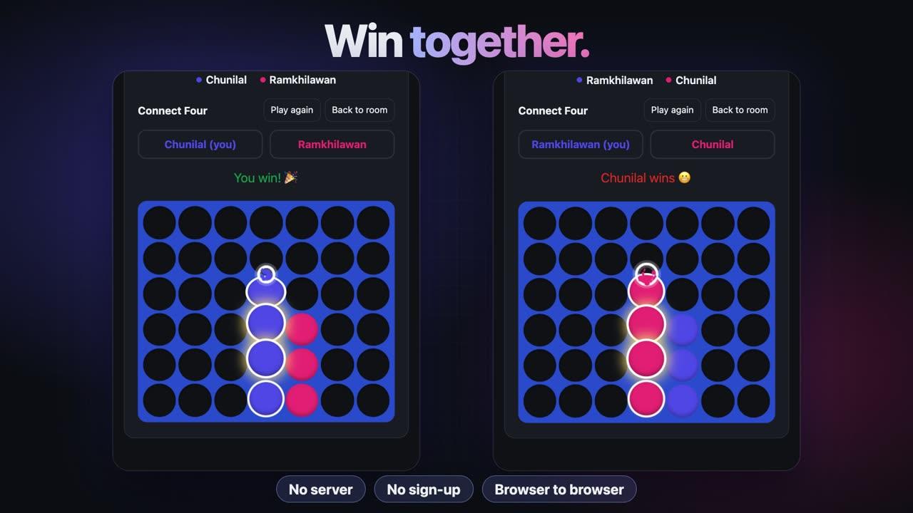](assets/brag/brag.mp4)

*20-second launch video, made with the [brag](https://github.com/latent-spaces/brag) skill. Click the picture to play it.*

### Gameplay

Both players' screens side by side, played by bots (`preview/game-demo.html`). Click a picture to play the clip.

| | |
| --- | --- |
| **Light Cycles**<br>[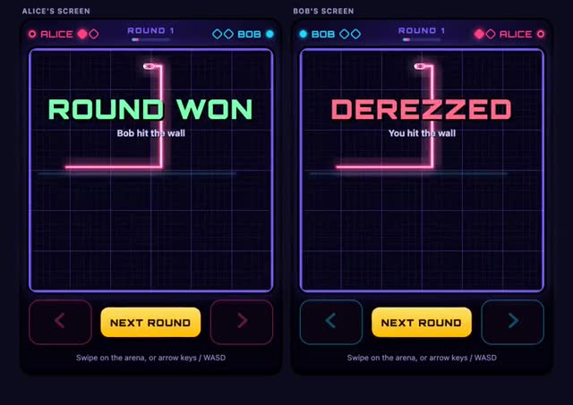](assets/gameplay/tron.mp4) | **Quick Draw**<br>[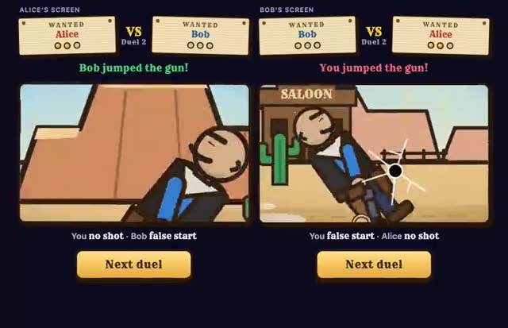](assets/gameplay/quick-draw.mp4) |
| **Draw & Guess**<br>[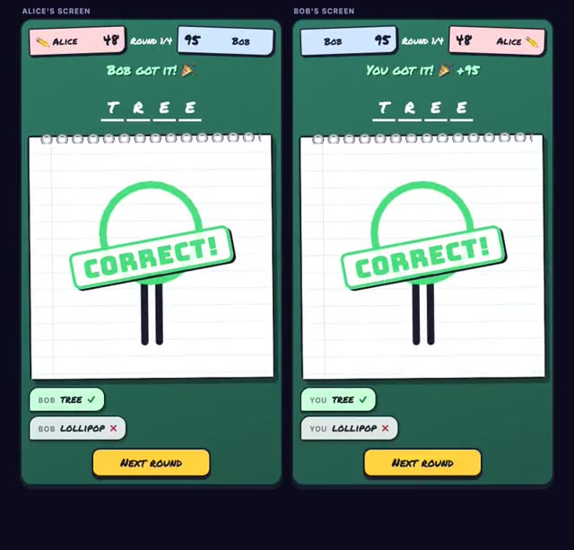](assets/gameplay/draw-guess.mp4) | **Blind Draw**<br>[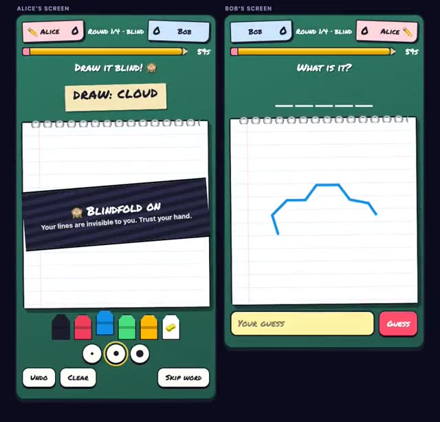](assets/gameplay/blind-draw.mp4) |
| **Emoji Charades**<br>[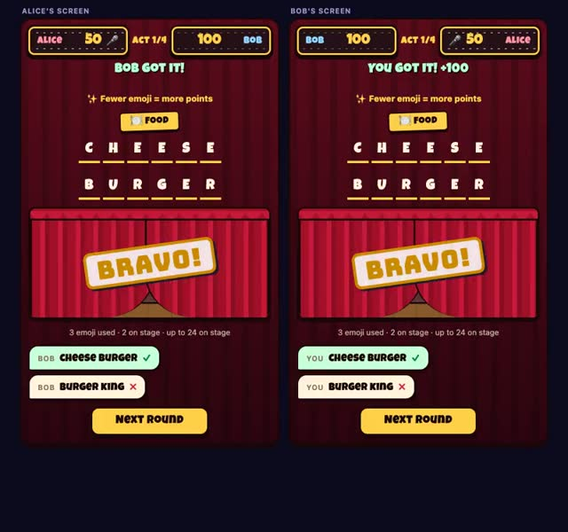](assets/gameplay/emoji-charades.mp4) | **Rock Paper Scissors**<br>[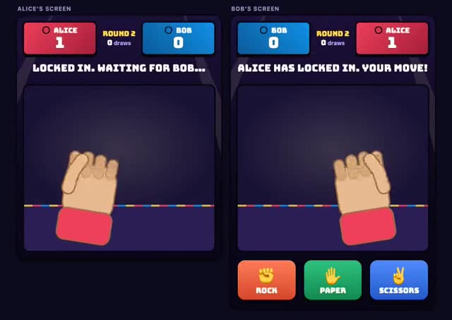](assets/gameplay/rps.mp4) |
| **Cup Pong**<br>[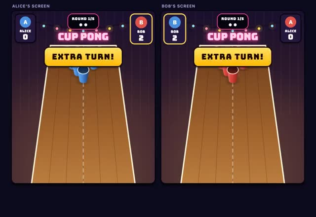](assets/gameplay/cup-pong.mp4) | **Tic-Tac-Toe**<br>[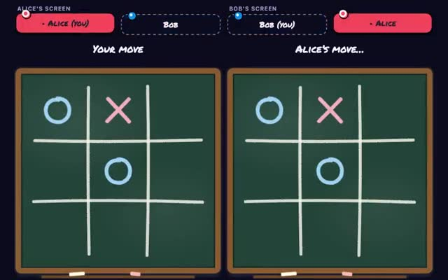](assets/gameplay/tic-tac-toe.mp4) |
| **Connect Four**<br>[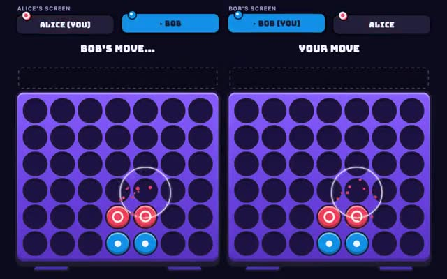](assets/gameplay/connect-four.mp4) | **Dots and Boxes**<br>[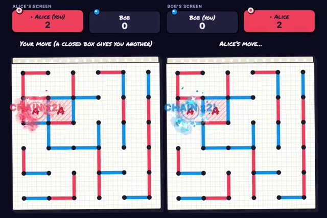](assets/gameplay/dots-and-boxes.mp4) |
| **Memory Match**<br>[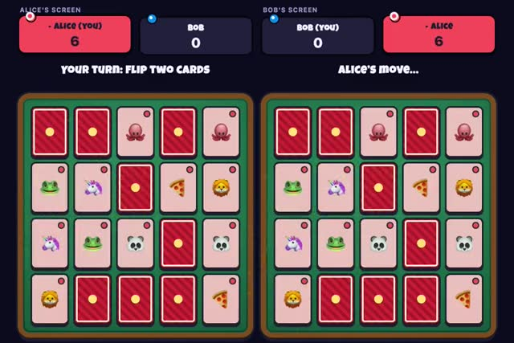](assets/gameplay/memory-match.mp4) | **Battleship**<br>[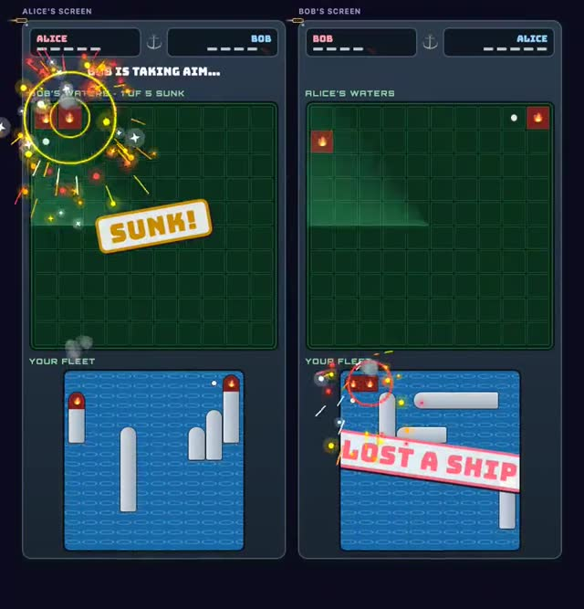](assets/gameplay/battleship.mp4) |
| **Hangman**<br>[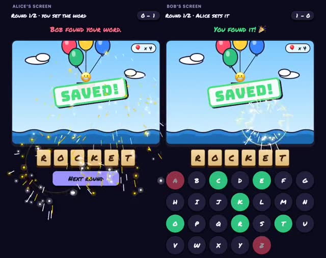](assets/gameplay/hangman.mp4) | **Trivia Duel**<br>[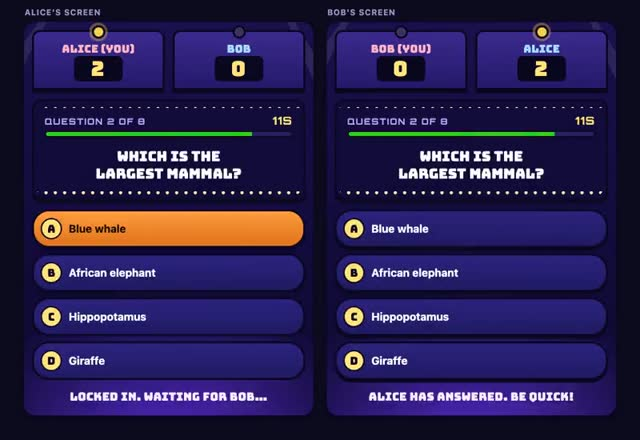](assets/gameplay/trivia-duel.mp4) |

- **Hosting:** static files on GitHub Pages (free, HTTPS, which WebRTC needs).
- **Connecting:** [Trystero](https://github.com/dmotz/trystero) uses free public Nostr relays only to
  introduce the two browsers. After that, all traffic is direct WebRTC.
- **Fairness:** no referee, so simultaneous moves use commit-reveal (each player sends a SHA-256 hash of
  their move and a secret first, reveals later, and the other side verifies it).
- **Room code:** 6 characters from `crypto.getRandomValues` XOR-mixed with `Date.now()`.

## How it fits together

A **room** is the long-lived thing two people share: the invite code, the connection, their names.
A **game** is something you start inside a room. Switching games never means re-joining.

1. **Home:** your name (random until you change it), create a room or join one by code or link, recent rooms.
2. **Room:** who is here, and a game picker (search, category chips, one card per game).
   Pick a game and the other player gets a proposal to accept or decline. If you both propose at once,
   the lower peer id wins. Either player can go back to the room at any time.
3. **Game:** runs inside the room until someone leaves it. A game that finishes gets a
   "Play again / Back to room" bar from the room.

The room is two players for now; a third person who joins is ignored.

| File | Job |
| --- | --- |
| `js/room.js` | The room: presence, names, proposals, game sessions, disconnect grace period. Owns the connection. |
| `js/net.js` | The real transport (Trystero), one channel. `js/memory-transport.js` is the in-memory one for tests. |
| `js/games.js` | The registry of games shown in the picker, plus search and tag filtering. |
| `js/games/<id>/` | One folder per game, loaded only when a game starts. |
| `js/main.js` | The two screens, the picker, and mounting whichever game is running. |
| `js/storage.js` | Recent names and rooms in `localStorage`. |
| `js/sound-map.js` | Which meme clips can play for which moment (one scenario, many clips, one picked at random). |
| `js/sound.js` | Plays them: one clip at a time, mute, loads on first tap. |
| `js/synth.js` | Sound effects made on the spot with Web Audio (wind, whistle, gunshot, beeps); respects the Sound button. |
| `js/sound-events.js` | Turns room changes and Cup Pong throws into scenario ids. |
| `js/juice.js` | Motion for game views on GSAP: title cards between rounds (themes `neon`, `western`, `marker`, `stage`), staggered entrances, count-ups, rubber stamps, camera-style shakes, screen wipes, letter scrambles. Respects reduced motion. Styles in `css/juice.css`. |
| `js/bake.js` | Paints an element's rich CSS background once into a bitmap, because Firefox repaints gradients whenever something moves over them. |
| `vendor/` | GSAP 3.15 and Pixi.js 8.23 (+ pixi-filters) copied from npm, loaded only by the games that use them. Versions and licenses: `vendor/README.md`. |
| `css/fonts.css` | Self-hosted display fonts (`assets/fonts/`): Bungee, Orbitron, Rye, Permanent Marker, Luckiest Guy, as `--font-game`, `--font-neon`, `--font-western`, `--font-marker`, `--font-cartoon`. |
| `js/fx.js` | Effects: glowing particles (stars, sparks, emoji), shockwave rings, fireworks, floating "+1" text, VICTORY / DEFEAT / DRAW banners, phone vibration. Games call it for their own moments. Add `?tune` to the URL for live sliders (Tweakpane). `preview/fx-demo.html?game=rps\|ttt\|c4\|dots\|mm\|bs\|tv\|result` plays a scripted match to watch them. |

Messages on the wire are `{t: kind, ...}`: `hello`, `propose`, `accept`, `decline`, `cancel`, `end`, and
`game` (which carries a game's own message, stamped with a session id so a late message from a game you
already left is dropped). `hello` carries a protocol version (`PROTOCOL_VERSION` in `js/room.js`); a
mismatch shows "ask your friend to refresh" instead of a silent hang.

## Adding a game

1. Add an entry to `GAMES` in `js/games.js`:
   `id, title, icon, tags, blurb, status, minPlayers, maxPlayers, load`, and optionally
   `layout: 'wide'` (a big stage instead of the 460px column), `layout: 'immersive'` (a game that paints its own
   full scene: a wider column with no room card around it) and `resumable: true`.
   `status: 'soon'` shows an unplayable "Soon" card.
2. Create `js/games/<id>/index.js` exporting `createGame({session, container})`. It may be async and
   returns `{destroy()}`. See `js/games/rps/index.js`.
   - `container` is an empty element the game owns until `destroy()`. Load your own CSS with
     `loadCss(new URL('./x.css', import.meta.url))` from `js/load-css.js`.
   - `session.players` is `[{id, name}]` sorted by id, the same order on both sides, so index 0 and 1
     are stable seats. `session.selfId`, `session.roomId` and `session.sid` identify you, the room and this game.
   - `session.send(msg)` sends to the other player. Set `session.onMessage = (msg, fromId) => {}` to receive.
     Messages that arrive before you set it are held and delivered once you do.
   - Call `session.finished({winnerId})` when the game is over (`winnerId` is omitted for a draw).
   - If `resumable: true`, the room waits about 20 seconds after a disconnect and calls
     `session.onPeerLeave(id)` and then `session.onPeerJoin(id)` if the same peer returns; resyncing state
     is the game's job. Otherwise a disconnect ends the game.
3. Keep rules and match state in a pure class with no DOM, and test it with `memorySessions()` from
   `js/memory-transport.js` (see `test/rps-match.test.js`). `js/crypto.js` has `sha256Hex` and `randomNonce`
   for commit-reveal.

## Features

- Turn-based games (`js/games/turn-match.js`): Tic-Tac-Toe, Connect Four, Dots and Boxes and Memory Match share one engine.
  Both browsers apply the same pure `rules.js` to the same moves, so only moves travel; illegal or out-of-turn moves are rejected.
  Who goes first and Memory Match's card layout come from the session id (`js/rng.js`), so both sides agree with nothing sent.
- Hidden-information games use commit-reveal, like RPS. Battleship: fleets are locked in by hash, the other side answers every shot
  from its own fleet, and at the end both fleets are revealed and checked against every answer (a lie shows as "may have cheated").
  Hangman: two rounds with roles swapped, the word is locked in by hash and each answer is checked at the reveal.
- Trivia Duel: 8 questions from `js/games/trivia-duel/questions.js` (add more there), picked and option-shuffled from the session id.
  1 point for a right answer, +1 for the faster right answer. Each browser times itself, so this is for friends.
  Memory Match, Trivia and the commit-reveal games are not cheat-proof against someone reading the page source or console.

- Draw & Guess and Blind Draw (`js/games/draw-guess/`): one player draws a secret word (3 to pick from, locked in by hash like Hangman)
  on a shared canvas while the other types guesses; 4 rounds, roles alternate. Strokes stream as small chunks of integer points in a
  1000 x 1000 canvas space, so any screen size looks the same. The drawer's side answers every guess honestly ("so close" when one
  letter off) and the guesser checks the revealed word against the hash, every answer and every hint. A right guess scores 50 to 100
  by speed (the drawer gets half). A hint letter appears at half time and at three quarters. Blind Draw is the same game with the
  drawer's own lines hidden until the round ends (`mode: 'blind'`, see `blind.js`). Add words in `words.js`. The look is a sketchbook
  on a desk: ruled paper with spiral rings, word choices dealt as index cards, crayons, a pencil that burns down as the timer, guesses
  as speech bubbles and a CORRECT! stamp.
- Emoji Charades (`js/games/emoji-charades/`): the describer picks one of three phrases (movie, food, place, animal, action; the guesser
  sees the category as a clue) and acts it out with an emoji palette only; the guesser types guesses. Same commit-by-hash and honest
  answers as Draw & Guess. **Scoring flag**: on (default), points come from how few emoji were used (100 for three or fewer, 10 less
  per extra, taken-back ones still count); off, from how fast the guess came. The first describer flips it before picking and the
  other side sees which rule is on. Add phrases in `phrases.js`, emoji in `emoji.js`. The look is a little theatre: marquee name
  boards, phrase tickets, curtains that open on a spotlit stage where each emoji drops in (or flies from the key you tapped), and
  applause.
- Light Cycles (`js/games/tron/`): two bikes on a 36 x 36 grid, steer by swipe, arrow keys/WASD or the two big buttons; hit a wall, a
  trail or the other bike and you crash. First to 2 rounds (a double crash replays). Lockstep: both screens run the same pure
  simulation (`rules.js`) and only turns travel, applied 2 ticks later on both sides, with a state hash checked as it goes ("the two
  screens disagree" if they ever drift). If the other side's input is late the round waits for it rather than drifting.
  Drawn with Pixi (WebGL) and a bloom filter: neon trails, bikes that glide between grid steps, engine sparks, a crash flash with a
  camera punch-in and a "derez" fade, plus a synthwave loop and engine hum from `js/synth.js`.
- Quick Draw (`js/games/quick-draw/`): a desert standoff, first to 3 duels. Wait for DRAW and tap; tapping early (or faster than a human
  can react) is a false start and loses. The wait is picked from the session id so both screens agree, with decoys during it (a crow, a
  gust, the other cowboy twitching). Each screen times its own player from the moment IT shows DRAW and reports it, so network delay
  never counts against anyone. The scene is inline SVG (`scene.js`: a little town, mesas, shaded cowboys) with five times of day, one
  per duel, and it is directed like a film: letterbox bars, camera cuts between the cowboys' eyes and gun hands while a heartbeat
  speeds up, a slow-motion shot with a tracer, a flying hat and dust, and a bullet hole on the loser's screen. Sound comes from
  `js/synth.js` (a whistled tune, wind, heartbeat, gunshot), so the game needs no image or audio files. Self-reported times mean a
  modified client could cheat: it is for friends.
- Cup Pong (`js/games/cup-pong/`): swipe to throw a ball at the other player's 10 cups, 5 rounds of 2 balls, one table bounce allowed,
  both balls in earns an extra turn, clearing every cup wins at once. Only the throw inputs travel; both sides replay them with the same
  deterministic physics (`physics.js`) and a mismatch is reported as a desync. A forgiveness helper (`aim-assist.js`) nudges near-misses.
  Resumable: a short connection drop is repaired by exchanging throw logs. Throwaway tuning pages: `preview/cup-pong-proto.html` (a tuning bench),
  `preview/cup-pong-match.html` (a match against a bot) and `preview/cup-pong-two.html` (the real game, two players on one page).
- Animated hands (`js/games/rps/hands-tube.js`): open, fist, three pumps while the network exchanges reveals, then both open at once.
- Player names and an optional room name (default room name "Kali Pahadi Ke Pichhe"), shared over the same P2P handshake.
  The name box starts with a random name from `DEFAULT_NAMES` in `js/names.js`; edit that list to change the pool.
- A name belongs to a room, not to you: it is saved with the room, so reopening that room's link, typing its code, or
  tapping it under "Recent rooms" brings the same name back. Nothing remembers a name across rooms or visits.
- Remembers your recent rooms in this browser (✕ forgets one). Saved data carries a version (`STORAGE_VERSION` in
  `js/storage.js`): older data is migrated, and data from a version this code does not understand is deleted on load.
- Invite by link, code, or QR (QR library is loaded from a CDN only when the QR is shown).
- `js/games/rps/hands3d.js` + `preview/hands3d.html`: an unfinished 3D-hands experiment (Three.js, WebXR generic hand model). Not used by the game yet.
- Animation previews: `preview/hands-tube.html`, `preview/hands3d.html`.

## Run locally

```bash
npm run serve        # http://localhost:8000
```

Open it in two windows. Click **Create room** in one, then open its invite link (or type its code) in the other,
and pick a game.

## Test

```bash
npm test             # Node's built-in runner, no dependencies to install
```

Covers the room protocol, the turn-based rules and engine, Battleship, Hangman and Trivia (including cheating attempts), (proposals, simultaneous proposals, stale-session messages, leaving, reconnect
grace period, version mismatch, malformed input), Rock Paper Scissors rules and commit-reveal (including
tampering), full two-player matches over an in-memory transport, Cup Pong's physics, aim helper and match
(replay, desync, resume), room codes, names and storage.

```bash
npm run smoke        # headless Chrome, about 30 s; needs Google Chrome or Chromium (set CHROME=/path if not found)
```

The browser smoke test (`test/browser/smoke.html`, run by `scripts/smoke.mjs`) mounts every ready game from the
registry twice over the in-memory network and plays through the real UI: Rock Paper Scissors by clicking two
rounds, Cup Pong through the intro and coin flip and a real swipe. It also fails on any uncaught page error.
After every deploy, run it against the live site: `SMOKE_BASE=https://<user>.github.io/<repo>/ npm run smoke` (it also checks the main page loads
and that the served game list has both games).
`npm run live` goes further: two Chrome pages act as two real peers on the deployed site, find each other through the public relays,
join one room and play RPS and Cup Pong over real WebRTC (`node scripts/live-p2p.mjs <url>` for another site). It runs on one machine,
so it does not prove two different networks.
You can open the same page by hand at `/test/browser/smoke.html` after `npm run serve`.
The real network path is checked by hand: two tabs locally, then two devices on different networks.

## Deploy to GitHub Pages

1. Create a **public** GitHub repo (Pages on free accounts needs a public repo) and push this folder to `main`.
2. Repo **Settings → Pages → Build and deployment → Source: Deploy from a branch**, branch `main`, folder `/ (root)`.
3. After about a minute the site is live at `https://<user>.github.io/<repo>/`.
4. Send a friend the invite link from the in-room **Copy invite link** button.

Every later `git push` to `main` redeploys automatically.

## Known limits (free tier)

- **Strict networks:** WebRTC uses free public STUN. Some corporate networks and carriers need a
  TURN relay, which is not free. If a friend cannot connect, try a different network.
- **Public relays:** discovery depends on public Nostr relays. If they are down, swap the import in
  `js/net.js` to the torrent or MQTT strategy (one-line change).
- **Friends only:** players trust each other's browsers. Commit-reveal stops peeking, but this is not
  cheat-proof against someone modifying their own client's score display.
- **No resume after a refresh:** game state lives only in the two browsers. Refreshing mid-game ends it;
  rejoin the room from "Recent rooms" and start again. Games that opt in with `resumable` survive a
  brief connection drop, not a reload.
- **Two players per room** for now.

## Game roadmap

Built from the original plan: Draw & Guess, Blind Draw, Emoji Charades, Light Cycles and Quick Draw.

Not built yet:

- **Color Code Duel** (Mastermind): each player sets a secret code of 4 pegs from 6 colors and cracks the other's; feedback is right
  color in the right place, and right color in the wrong place. Only lukewarm so far, so it was left out.
- **Liar's Dice** (parked, needs more design before building). Each player has 5 dice hidden under a cup and sees only their own. They
  take turns bidding on the total across all 10 dice ("at least four 3s") and the next player raises the bid or calls "Liar!"; the cups
  lift, and whoever was wrong loses a die. Open questions: how much the game suffers without seeing the other person's face (probably
  best on a voice call), whether ones are wild, how many dice to start with, and the commit-reveal for the dice (reuse RPS's).
- Draw & Guess extras: One Line and Ink Limit modes, and Telephone (each player draws the other's guess).

## Not built yet

A room of more than two people (with a computed leader), a "room is full" screen, audio and video calls,
chat, a room-wide scoreboard, and de-duplicating identical display names (two players can still draw the
same random name, about a 1 in 25 chance).

## Sound

Moments in the game play short Hindi meme clips (a few wordless English ones, no English music).
The mapping is `SCENARIOS` in `js/sound-map.js`: add or remove a clip name there and run

```bash
npm run sfx
```

to copy the clips from the meme-music library (`SFX_LIBRARY=...` if it is not at the default path) into
`assets/sfx/`. `HELD_BACK` in that file lists clips left out on purpose. Players mute with the Sound
button in the room header; the choice is remembered. Browsers keep audio off until the first tap, so
the first tap anywhere on the page turns it on.

Scenario ids are `<scope>.<moment>`: `room.*` and `game.*` fire from the room for any game; every game has its
own scope (`rps`, `cp`, `board` for the shared board-game moves, `mm`, `db`, `bs`, `hm`, `tv`, `dg`, `tr`, `qd`) and plays
those from its view, next to the effect it already shows for that moment. A scenario can set `chance` (how
often it makes a sound at all, so ordinary moves stay a treat) and `maxSecs` (cut the clip there). The move
that ends a game plays only the room's win/lose/draw sound. `test/sound-events.test.js` scans the code and
fails if an id is played that is not mapped, or mapped but never played.

A game plays its own moments by calling `play('<scenario id>')` from `js/sound.js`. A game that plays
its win/lose/draw sound after its animation sets `ownsResultSound: true` in `js/games.js`; otherwise the
room plays it the moment the game reports a result.
